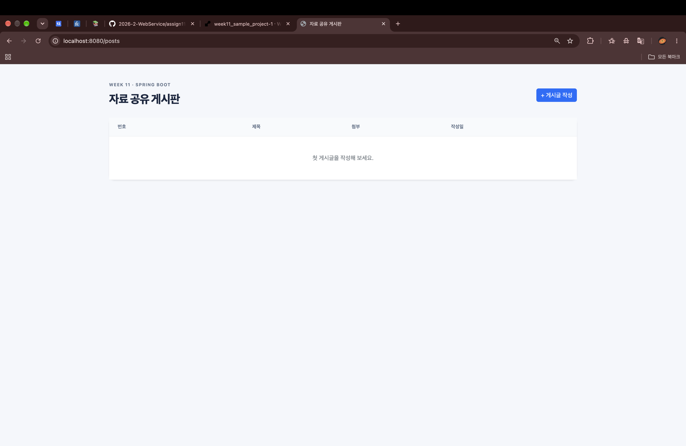
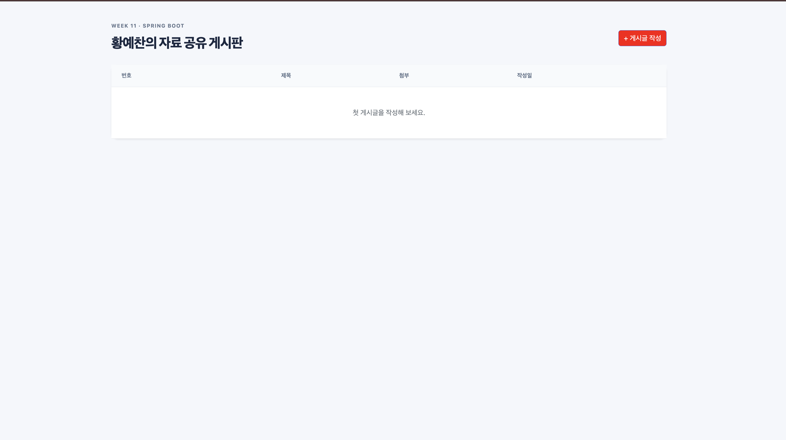
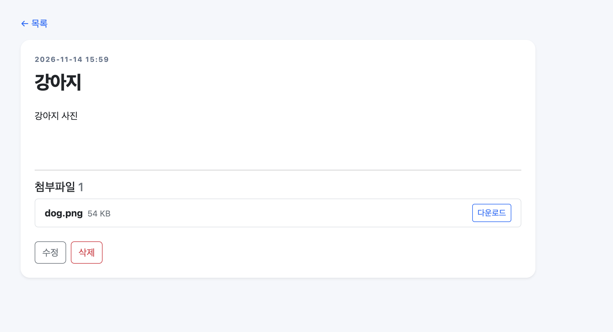
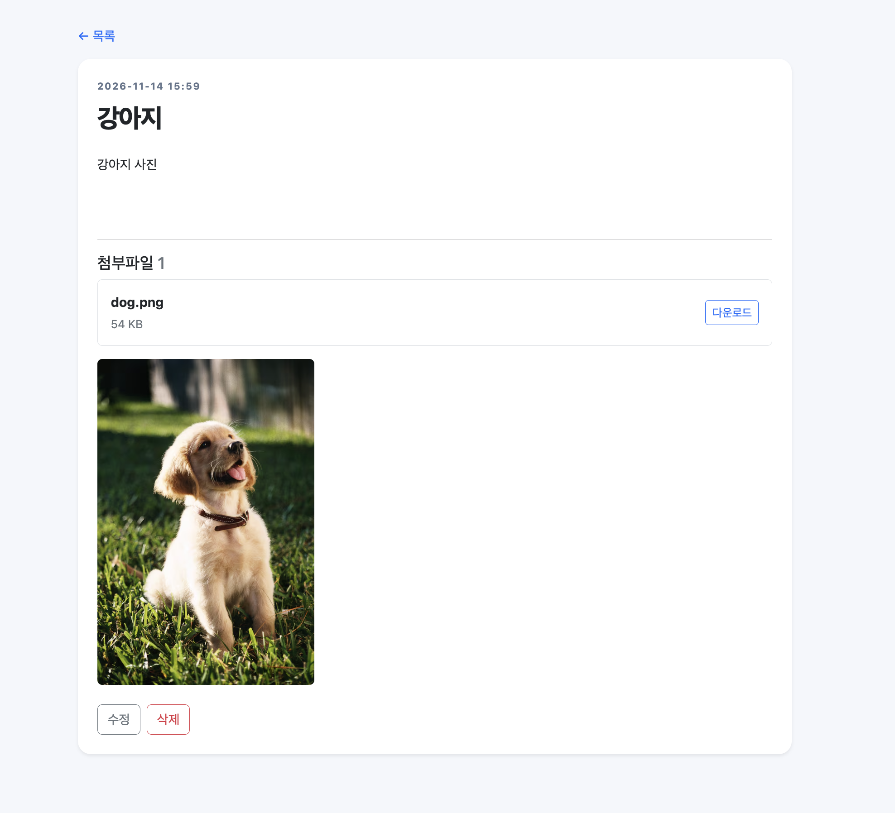
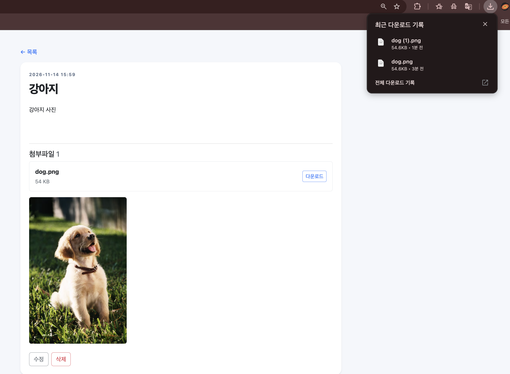
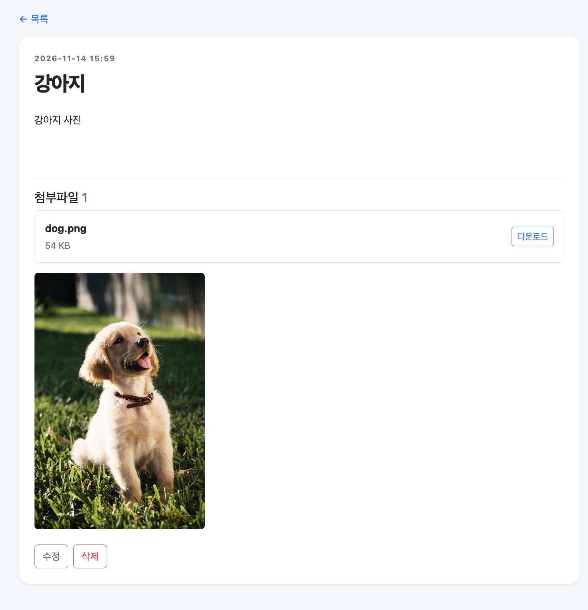

# 1 Project Information: 프로젝트 소개, GitHub Repository URL, Render Deployment URL

## 프로젝트 소개

Spring Boot Sample Project를 바탕으로 만든 자료 공유 게시판이다. 게시글을 작성·조회·수정·삭제할 수 있고, 글에 파일을 첨부하거나 첨부파일을 다운로드할 수 있다. 기존 화면의 제목, 버튼 색상, 파일 목록 배치를 변경하고, 게시글 상세 화면에 첨부 이미지를 보여주는 미리보기 기능을 추가했다.

## GitHub URL

- 과제 제출 저장소: https://github.com/2026-2-WebService/assign11-c01-22500802
- 개인 저장소: https://github.com/yechan-7942/week11_sample_project

## Render URL
- render : https://week11-sample-project-1.onrender.com/posts

# 2 Installation

환경 변수 설정
 DB_URL, DB_USERNAME, DB_PASSWORD

# 3 Source Code Exploration

## 1. PostController, PostService, PostRepository는 각각 어떤 역할을 하며, 서로 어떻게 연결되는가?

PostController는 브라우저의 요청을 받고 어떤 화면을 보여줄지 정한다. PostService는 게시글 저장·수정·삭제 같은 처리를 맡고, PostRepository는 JPA를 이용해 DB에 접근한다. 글을 작성하면 PostController.create() → PostService.create() → PostRepository.saveAndFlush() 순서로 이어지며, 파일 저장은 서비스에서 FileStorageService.store()에 맡긴다.

## 2. 게시글 작성 시 HTML Form의 입력값과 첨부파일은 Controller에 어떻게 전달되는가?

posts/form.html은 multipart/form-data 형식으로 POST /posts 요청을 보낸다. 제목과 내용은 @ModelAttribute("postForm")을 통해 PostForm에 담기고, 첨부파일은 @RequestParam(name = "files")를 통해 List&lt;MultipartFile&gt;로 전달된다. @Valid가 입력 조건을 검사하며, 문제가 있으면 BindingResult로 확인한 뒤 작성 화면을 다시 보여준다.

## 3. Post와 Attachment Entity는 어떤 관계이며, @ManyToOne과 @OneToMany는 각각 어떤 역할을 하는가?

게시글 하나에 여러 첨부파일이 연결될 수 있으므로 Post와 Attachment는 일대다 관계이다. Post의 @OneToMany는 첨부파일 목록을 나타내고, Attachment의 @ManyToOne은 각 첨부파일이 속한 게시글을 나타낸다. 첨부파일 테이블의 post_id가 게시글을 가리키며, Post.addAttachment()는 목록에 파일을 추가하면서 파일 쪽의 게시글 정보도 함께 설정한다.

## 4. cascade = CascadeType.ALL과 orphanRemoval = true는 어떤 역할을 하며, 실제 디스크에 저장된 파일에도 영향을 주는가?

CascadeType.ALL은 게시글에 수행하는 저장·삭제 등의 JPA 작업이 연결된 첨부정보에도 적용되게 한다. orphanRemoval = true는 게시글과의 관계에서 제거된 첨부정보를 DB에서도 삭제하도록 한다. 이 설정은 실제 디스크 파일까지 지우지는 않으므로, PostService.delete()에서 FileStorageService.deleteIfExists()를 호출해 실제 파일을 따로 삭제한다.

## 5. MultipartFile은 무엇이며, 업로드된 파일은 어떤 과정을 거쳐 서버에 저장되는가?

MultipartFile은 사용자가 첨부한 파일의 이름, 크기, 내용 등을 다룰 수 있게 하는 Spring 인터페이스이다. PostService.create()는 첨부파일을 하나씩 FileStorageService.store()에 넘기고, 이 메서드는 파일명·확장자·크기를 검사한 뒤 저장 경로를 만든다. 이후 입력 스트림으로 파일을 읽어 Files.copy()로 저장하며, 반환된 첨부정보는 게시글에 연결되어 DB에 저장된다.

## 6. 파일을 원본 이름 대신 UUID 기반 파일명으로 저장하는 이유는 무엇인가?

서로 다른 사용자가 같은 이름의 파일을 올려도 충돌할 가능성을 줄이기 위해 UUID 기반 저장 이름을 사용한다. 원본 이름은 화면 표시와 다운로드에 사용하고, 실제 저장에는 UUID.randomUUID()로 만든 이름과 확장자를 사용한다. 원본 이름과 저장 이름은 Attachment에 각각 보관한다.

## 7. 파일 다운로드 시 Resource, ResponseEntity, Content-Disposition은 각각 어떤 역할을 하는가?

Resource는 서버에 저장된 파일을 Spring이 읽을 수 있도록 표현한 객체이다. ResponseEntity는 HTTP 상태, 헤더, 파일 본문을 묶어 응답하는 데 사용한다. Content-Disposition에는 다운로드 방식인 attachment와 원본 파일명을 넣어 브라우저가 해당 이름으로 파일을 내려받도록 알려준다.

## 8. 파일 저장 과정에서 normalize()와 startsWith()를 사용하는 이유는 무엇인가?

normalize()는 경로에 포함된 .이나 .. 같은 요소를 정리한다. 정리한 경로가 uploadDir로 시작하는지 startsWith()로 확인해 업로드 폴더 밖의 경로를 사용하지 못하도록 검사한다.

## 핵심 코드에 설명 주석을 추가한 메서드

- PostController.create(): 작성 요청 수신, 입력 검사, 파일 목록 전달, 저장 후 상세 화면 이동
- FileStorageService.store(): 파일 검증, UUID 이름과 저장 경로 생성, 실제 파일 복사
- AttachmentController.download(): 첨부정보 조회, 실제 파일 조회, 다운로드 응답 생성

# 4 Customizing: 수정 내용 3가지 및 변경 전/후 결과

1. Text 수정

수정 파일: src/main/resources/templates/posts/list.html

변경 전에는 제목이 자료 공유 게시판이었고, 변경 후에는 황예찬의 자료 공유 게시판으로 바꿧다.

2. Style 수정

수정 파일: src/main/resources/static/css/app.css

변경 전에는 버튼 배경이 Bootstrap 기본 파란색이었고, 변경 후에는 .btn-primary의 배경을 빨간색으로 바꿨다.

3. UI/Data 수정

수정 파일: detail.html, app.css

변경 전에는 파일명과 크기가 한 줄에 표시됐고, 변경 후에는 파일명 아래에 크기를 표시하고 다운로드 버튼은 오른쪽에 배치했다.

버튼 배경색 변경은 .btn-primary를 사용하는 다른 버튼에도 적용된다. 파일 목록에는 여백을 추가했다.

### 제목·버튼 변경 후

### 파일 목록 변경 전

파일명과 파일 크기가 한 줄에 표시되던 화면이다.

### 파일 목록 변경 후

파일명 아래에 파일 크기를 표시하고, 다운로드 버튼은 오른쪽에 배치한 화면이다.

# 5 New Feature: 이미지 미리보기 구현 내용

## 수정 파일

- src/main/java/edu/handong/web11/controller/AttachmentController.java
- src/main/resources/templates/posts/detail.html

## 처리 흐름

1. 게시글에 첨부된 파일을 하나씩 확인한다.
2. JPG, JPEG, PNG, GIF 이미지 파일이면 사진을 보여줄 자리를 만든다.
3. 브라우저가 첨부파일 번호를 이용해 서버에 이미지를 요청한다.
4. 서버는 파일 정보를 조회하고, 저장 폴더에서 실제 파일을 찾는다.
5. 서버가 이미지 종류와 파일 내용을 보내면 게시글 안에 사진이 나타난다.

# 6 Testing & Deployment

## 로컬 테스트

### 01. Sample Project 초기 실행 화면

### 02. 파일 업로드 성공 화면

### 03. 파일 다운로드 성공 화면

### 04. 이미지 미리보기 실행 화면

01_samle.png는 변경 후 목록 화면이며, 01_sample_pre.png는 미리보기 추가 전의 상세 화면이다.

## Render 배포

Render 배포 주소 : https://week11-sample-project-1.onrender.com/posts

# 7 Weekly Review:

## 새롭게 배운 내용 3가지

1. 요청 처리와 DB 접근의 구분에 대해서 제대로 알게 되었다. 
2. 실제 파일과 파일 정보의 구분: 파일 내용은 저장 폴더에 있고, DB에는 파일명과 타입 등의 정보가 있다. DB 정보와 실제 파일은 삭제할 때도 각각 처리해야 한다.
3. 다운로드와 미리보기 응답의 차이: 같은 파일도 다운로드용 헤더를 넣으면 내려받게 할 수 있다.

## 어려웠던 점과 해결 방법
처음에 전체적인 구조를 이해하는게 어려웠다.  그래서 게시글 저장 버튼을눌렀을때 어떤 메서드가 실행되는지 순서대로 확인했디.

## AI 활용 내용 및 느낀 점
Ai 활용 : 이미지 미리보기 구현에서 도움을 받았다. 

느낀점 : Ai의 설명 코드가 이해하는데 도움이 되었지만 설명만 읽는거랑 직접 실행해서 확인하는것은 다르다고 느꼇다. 실제로 어떤식으로 작동하는지 확인하는 과정이 더 기억에 잘 남는것 같다. 